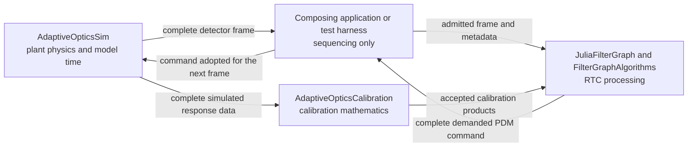

# Design

## Purpose

`AdaptiveOpticsCalibration.jl` owns reusable scientific algorithms that turn
explicit calibration inputs into calibration products and numerical
diagnostics. Its intended users are calibration developers, commissioning
workflows, simulation validation, and RTC preparation tooling.

## Package boundary decisions

The package split is governed by four decisions:

| ID | Decision |
|---|---|
| CAL-D001 | `AdaptiveOpticsSim` is the physical plant simulator. It owns model time, optical propagation, detector-frame formation, physical actuator response, truth products, and simulated physical response acquisition. It does not own an RTC. |
| CAL-D002 | `AdaptiveOpticsCalibration` owns reusable calibration mathematics over explicit specifications and numerical inputs. It does not acquire frames, sequence a plant or instrument, or apply products in a per-frame RTC callback. |
| CAL-D003 | JuliaFilterGraph and FilterGraphAlgorithms own RTC graph execution, detector-frame processing, WFS estimation, reconstruction application, controller state, VDM/PDM routing and conditioning, feedback, and transactional runtime behavior. |
| CAL-D004 | A composing application, SRT, or test harness owns cross-package sequencing, calibration campaigns, pacing, artifacts, and activation. The composing layer owns no scientific algorithm merely because it connects the packages. |

The intended data and authority flow is:



Neither AOS nor FGA is required to depend on the other. A dedicated integration
environment may depend on both. This package remains a dependency leaf with
respect to AOS and FGA: they may depend on it, but it must not depend on them.

The lockstep reference composition forms frame `n` under the command adopted
after frame `n - 1`. FGA processes frame `n` and publishes a complete demanded
PDM command for sequence `n`; successful adoption makes that command active for
frame `n + 1`. Rejection or deferral does not imply a hidden command-hold
policy. AOS owns model time, while an application or SRT owns wall-clock pacing
and transport.

A demanded PDM command becomes a physical response only when the AOS
deformable-mirror model consumes it. Requested-to-demanded constraint feedback
inside the RTC is distinct from AOS realized-command or realized-surface truth
telemetry.

## Ownership model

`FocalPlaneSharpening` applies this interface to four complete scalar CPU
calculations: a median-filtered weighted image objective, a supplied SPSA probe
pair, a two-metric SPSA gradient, and an explicit-state Adam step. Radius,
coefficient dimensions, SPSA direction/perturbation, and Adam parameters are
explicit. Optimizer moments and iteration are supplied state and returned as
independent next-state storage; plans and replaceable workspaces carry no
history. Basis/order, homogeneous units, measurement association, command
conversion, acceptance, and equipment remain caller-owned. The reviewed
[sharpening design](docs/DESIGN_SHARPENING.md) specifies the equations and
source boundary. No accelerator or instrumental improvement is claimed.

The public interface separates five roles:

| Role | Contract |
|---|---|
| Method | Cold selection of equations and scientific options |
| Specification | Algorithm-owned description of dimensions, coordinates, units, and compatible input representation |
| Plan | Run-immutable prepared numerical contract |
| Workspace | Replaceable scratch whose recreation cannot affect the scientific result |
| Product | Caller-visible scientific product and diagnostics |

The routine interface is:

```julia
prepare(method, specification)
process(plan, inputs)
process!(result, plan, inputs)
process!(result, workspace, plan, inputs)
```

The output-first `process!` order matches Julia's mutating-function convention,
FGA's complete-operation form, and makes caller ownership explicit.
Preparation may allocate and fail. Processing may mutate only the result and
workspace. Plans do not retain exact transient input or output bindings.

`process` allocates both result and workspace. The three-argument `process!`
form allocates workspace and may therefore allocate scratch. Callers requiring
repeatable scratch use the explicit-workspace form. `allocate_result` and
`allocate_workspace` are advanced public, non-exported extension seams; a
method with no scratch can return `nothing` from `allocate_workspace`.

## Namespaces

Scientific types belong in domain modules. The initial expected modules are:

- `Reconstructors`
- `InteractionMatrices`
- `DOCRIME`
- `Diagnostics`
- `ProbeBases`
- `ModalBases`
- `PhaseRetrieval`
- `Misregistration` (complete-data meta-sensitivity estimation)
- `Tomography` (bounded numerical preparation only)
- `OpticalGains` (complete-image modal sensitivity estimation)
- `ReferenceFrames` (dark moments, lamp centroids, and pyramid references)

Types select behavior through dispatch. Each family uses the common interface
rather than defining algorithm-qualified preparation and execution verbs.

`ProbeBases.SpatialSinusoidalPushPull` constructs spatial sine/cosine modes
from explicitly ordered physical actuator positions `rⱼ = (xⱼ, yⱼ)` and
frequency vectors `kᵢ = (kₓᵢ, kᵧᵢ)` in cycles per matching coordinate unit.
The dimensionless mode equations are `sin(2π kᵢ⋅rⱼ)` and `cos(2π kᵢ⋅rⱼ)`.
Modes are interleaved sine/cosine by frequency; command rows are positive and
negative sine, then positive and negative cosine, with one explicit amplitude
per mode in caller-defined command units. Callers explicitly select no
normalization or sampled-peak normalization and a raw sampled-peak guard.
DC and sampled near-null rows are rejected. Geometry, pupil selection,
centering, piston removal, orthogonalization, frequency choice, sequencing,
and exposure association remain outside this method. A partial spatial Fourier
basis yields modal directional response measurements; it does not establish
the full physical zonal interaction matrix. The sampled-peak guard does not
establish independence or rank across supplied frequencies.
RMS diagnostics accumulate represented basis samples using a floating type
promoted with Float64, preserving wider input precision. Sampled peaks retain
the basis representation for the declared normalization.

`ModalBases` uses *sampled influence-function eigenbasis* for the eigenbasis
of the unnormalized Gram matrix of sampled corrector influence functions. It
does not call that product a Karhunen–Loève basis unless the input contract
contains the physical covariance that gives the term its statistical meaning.
It also owns explicit-array modal OPD expansion. That operation evaluates a
caller-supplied sampled basis and coefficient vector into an OPD product; it
does not select a physical basis, synthesize random coefficients, or place the
product at an optical location. NCPA remains a physical optic owned by AOS.

`PhaseRetrieval` owns complete-observation nonlinear inverse mathematics such
as LiFT. A concrete-parametric forward-model contract supplies physical model
rates and analytic derivatives while retaining optical propagation in the
plant package. The plan may retain the run-immutable concrete model, but model
workspace and exact observation or result bindings remain outside the plan.

`Misregistration` denotes a numerical domain module, not the physical AOS
`Optics.Misregistration` type. It may estimate ordered offsets from an explicit
reference response, meta-sensitivity matrix, and observed response. AOS owns
derivatives of its physical DM/WFS response and interpretation of the offsets
as shifts, rotations, or scalings. No rounded estimate, mutable SPRINT campaign,
or zero-point reacquisition belongs in this numerical module.

`Tomography` may prepare explicit-array covariance, fitting, and reconstructor
products. Its specifications must identify source/layer coordinates, sample and
slope ordering, units, and noise conventions. AOS extracts physical geometry,
detector and atmosphere parameters, and truth; FGA applies an accepted matrix
per frame. This namespace does not admit plant objects, optical propagation,
per-frame reconstruction, campaign sequencing, or artifact ownership.

`OpticalGains` owns the complete-image numerical mask/FFT modal-sensitivity
calculation. Its CPU reference contract begins with an explicit complete
detector-frame image, finite complex focal-plane mask, and aligned modal basis;
it publishes signed modal ratios, complex sensitivities, weak-mode flags, and
flux diagnostics. AOS retains physical pyramid modulation, detector-frame
formation, and plant truth. FGA retains its separate live dither-window
demodulation, state, gain-update cadence, and application policy. This module
does not normalize a basis, infer a physical camera, retain a history, or
accept AOS/FGA objects.

`ReferenceFrames` owns bounded numerical processing of complete batches and
explicit scientific state.
`DarkFrameMoments` reports Float64 Welford means and unbiased variances from
unsigned row × column × exposure ADC samples. `LampReference` averages the
individual deployed centroids in detector pixels, retaining every interleaved
x/y row. Its per-ROI eligibility requires all intrinsic training validity and
the declared minimum flux; a global ADC rail violation invalidates the entire
batch. No instrument-specific active count is imposed. Inputs must explicitly
declare absolute centroids: acquire with zero subtraction reference, or add
back the explicitly known deployed reference to residuals before calling.
Products preserve diagnostics for every ROI, including inactive positions.
The caller owns acquisition, exposure association, artifact storage,
acceptance, and activation. Workspace is reset every call and retains no
calibration history.
`DarkFrameState` and `LampReferenceState` are explicit scientific histories for
ordered, bounded incremental reduction with the same equations. They own their
arrays and a prepared contract with copied lamp thresholds; they retain no
input frames.
`process!(state, plan, inputs)` completes one state update, accepting a frame
or partial batch up to the declared exposure count. State is the caller-owned
result of that operation, never workspace. `process!(product, workspace, plan,
state)` extracts the existing product only at the exact declared count, without
advancing state. Constructing a fresh state resets the history. State updates
preserve every exposure, numerical-failure flags and diagnostics; invalid
samples do not disappear through selection or retry. Sequential partitions
use the global exposure index and the same recurrence as complete batches.
Merging independently reduced states is not supported. There is no graph
adapter, exposure association, transaction or progressive publication here.

The public state names combine the existing `DarkFrame` and `LampReference`
scientific families with the explicit-state role defined below. `count` is the
number of supplied exposures; `sum_squared_deviations` is Welford M₂ in squared
ADC counts. Other state quantities retain their existing product/workspace
names and units. No transport or campaign vocabulary is introduced.

`PyramidReference` averages already-normalized ordered successful pyramid
frames. For selected pixel `k`, pupil `p` and retained exposure `n`, its input
is `x[p,k,n] = calibrated_selected[p,k,n] / μ[n−1]`, where `μ[n−1]` is
FGA's previous successful full-pupil mean. FGA's current `μ[n]` averages all
calibrated pixels in all four pupils, including masked pixels. Its first
successful output is zero because its initial gain is zero. The composing
application must discard priming exposures and preserve successful-frame order;
AOC cannot establish those historical preconditions from the supplied arrays.
AOC never normalizes again or changes FGA normalization history.

For exactly `N` retained exposures, `reference_pixels[p,k] = Σₙ x[p,k,n]/N`
is dimensionless Float64. The bounded recurrence is `mₙ = mₙ₋₁ +
(xₙ − mₙ₋₁)/n` with `m₀ = 0`. The modal reference is
`modal_reference[i] = −ΣₚΣₖ R[i,(p−1)K+k] reference_pixels[p,k]`.
Thus the reconstructor columns are pupil-major (`vec(permutedims(pixels))`),
not Julia's linear order of the four-row pixel matrix. Each explicitly
configured `row_units[i]` labels the coordinate of row `i`; R has those units
per dimensionless input and the modal product retains those units without
conversion. All R entries must remain finite after Float64 conversion.

Finite reconstruction pixels, finite strictly positive current full-pupil
means, and raw unsigned ADC samples strictly below the declared rail are
required for `Valid`. All exposures contribute; any numerical or rail failure
is sticky and yields zero reference arrays with `Invalid`. Diagnostics retain
the raw ADC maximum and minimum current full-pupil mean (NaN propagates).
No signal threshold, centroid, ROI flux, eligibility, optical gain, or flat-field
criterion is inferred. `PyramidReferenceState` owns bounded Float64 means,
count and diagnostics, and binds the exact logically immutable prepared plan.
Preparation owns one Float64 reconstructor copy; state shares that copy rather
than duplicating a potentially large matrix. Specification is cold authoring
input and may refer to the caller matrix until preparation. State retains no raw
frame history or transient caller input binding. Reset, chunk, extraction and
no-merge semantics match the other reference states above.

The pyramid identifier preflight uses the settled equation and the FGA/RTC
sources recorded in `MIGRATION.md` as scientific authority:

| Identifier | Kind and scope | Meaning and non-meanings | Layer / source | Rejected alternatives |
|---|---|---|---|---|
| `PyramidReference`, `PyramidReferenceSpecification`, `PyramidReferencePlan`, `PyramidReferenceInputs`, `PyramidReferenceProduct`, `PyramidReferenceWorkspace`, `PyramidReferenceState` | Public ReferenceFrames types | Pyramid reference method and existing interface/ownership roles | Domain / pyramid equations; package ownership model | New generic entry points, lamp/centroid names |
| `rows`, `columns`, `selected_pixel_count`, `exposure_count` | Dimensions | Detector dimensions, per-pupil selected count K, exact retained N | Mathematical / input shapes; existing rows/columns convention | Inferring physical geometry from length |
| `reconstruction_pixels`, `mean_pupil_intensity`, `raw_frames` | Input fields | Dimensionless FGA output x, current calibrated full-pupil μ, unchanged unsigned ADC | External / FGA output; settled scientific contract | Slopes, ROI flux, renormalized pixels |
| `reconstructor`, `row_units`, `modal_reference` | Specification/plan and product | R, explicit row coordinate unit labels, negative reconstructed reference | Mathematical / RTC sign and pupil-major equation; existing field_units metadata idiom | Inferred radians, command units or positive Rm |
| `reference_pixels`, `count`, `minimum_mean_pupil_intensity`, `adc_maximum`, `finite`, `positive_mean`, `below_rail`, `adc_upper_rail` | Product, workspace and state | m, retained count, min μ, max raw ADC, sticky numerical/rail diagnostics and explicit rail | Mathematical / equations above; ReferenceFrames diagnostic conventions | Raw history, acceptance threshold, eligibility mask |

`Diagnostics.RepeatedResponseMoments` summarizes explicit measurement × repeat
vectors with Float64 means, unbiased coordinate variances, conditional
independent-repeat mean standard errors, and a compact centered covariance
factor. Counts describe supplied vectors, not underlying detector frames.
The mathematical covariance rank is at most repeat count minus one; the
method does not infer independence, correct temporal correlation, invert the
covariance, or choose acceptance thresholds. Existing zonal push-pull estimates
can be supplied as repeated vectors. Equations, units, numerical outcomes and
uncertainty assumptions are documented in
[repeated response moments](docs/DESIGN_RESPONSE_MOMENTS.md).

## Cross-package vocabulary

The packages use the same ownership concepts even where their public surface
has different breadth:

| Concept | This package | AdaptiveOpticsSim | FilterGraphAlgorithms |
|---|---|---|---|
| Cold intent | Method and specification | Definition or domain configuration | Declaration and configuration |
| Prepared numerical contract | Plan | Plan | Plan |
| Persistent mutable history | Algorithm-specific state, when justified | State | Committed and candidate state |
| Replaceable scratch | Workspace | Workspace | Workspace |
| Caller-visible result | Product | Product | Output Port storage |
| Complete operation | `process!` | Domain verb such as `reconstruct!` | Four-argument `process!` |
| Exact repeated-run binding | Outside the minimal interface | Prepared execution owner | Prepared Algorithm/Graph owner |

The shared `process!` spelling denotes the same basic input-to-product role.
FGA adds bounded-work, transaction, progressive-processing, and graph
requirements. AOS retains domain verbs because it covers physical operations
whose meanings should remain explicit. These are separate Julia generic
functions unless a package deliberately imports and extends another package's
binding.

## Non-goals

The package does not own:

- plant propagation or detector simulation;
- a frame, stream, or workflow graph engine;
- transport, PipeWire, or device protocol integration;
- exposure association or equipment sequencing;
- transactional graph state, progressive publication, or runtime properties;
- calibration artifact serialization, persistence, acceptance, or activation;
- instrument-specific authority, geometry, or commissioning policy.

A HEART-like SRT may depend on this package for mathematics while owning
workflow and artifact lifecycle. FilterGraphAlgorithms may adapt selected
operations to its bounded graph contract. AdaptiveOpticsSim remains the plant
and supplies simulated observations and truth products.

## Dependency direction

This package must not depend on AdaptiveOpticsSim, JuliaFilterGraph,
FilterGraphAlgorithms, PipeWire, or an instrument package. Those packages may
depend on this small numerical package or may be composed with it by an SRT or
test harness.

Optional accelerator support belongs in package extensions. Accelerator
residency and completion behavior must be part of each concrete algorithm's
documented contract; the core interface does not invent a backend registry.
`KernelExecution` is the explicit target for the current KernelAbstractions
extension. Supported operations keep array-valued scientific storage and
prepared coefficients on the selected backend, may use compact host mirrors
for validity and diagnostics, and synchronize before `process!` returns. The
package does not capture CUDA or HIP graphs.

## State and transactions

The minimal interface intentionally has no `commit!`, `discard!`, `start!`,
`finish!`, or `abort!`. Complete-window batch estimators fit directly.
Incremental estimation is admitted only when the evolving values are
scientifically reusable outside an RTC. Such an algorithm must define an
explicit state owner and reset semantics instead of disguising persistent
history as workspace.

RTC candidate/committed state remains with FilterGraphAlgorithms. SRT campaign
progress, retry, approval, and activation remain with the SRT.

## Products and diagnostics

Products are typed scientific values, not generic status dictionaries. A
reconstructor product may contain a control matrix, retained-rank information,
residual measures, and propagated-noise diagnostics. Every product must state
its coordinate ordering, basis, units, normalization, and validity conditions.

File formats and artifact identifiers remain outside the numerical product.
The SRT wraps an accepted product with provenance, versioning, persistence, and
activation metadata.

## Resource claims

The interface does not promise hard real-time behavior or universal zero
allocation. Each algorithm must separately document and test supported numeric
types, array backends, repeated-call allocations, determinism, and accelerator
completion behavior. CPU implementations are the scientific reference unless
an algorithm documents another authority. The current KernelAbstractions
surface covers structured interaction-matrix estimation, probe-basis
construction, interaction-matrix stability, complete-image gain sensing, and
explicit-coordinate von Kármán covariance assembly.
Reconstructors and DO-CRIME remain on the CPU reference path because their
principal work is dense factorization or solve,
which should use an established accelerator linear-algebra implementation if
a measured calibration workflow requires device execution.

This package's batch-oriented resource policy does not weaken the execution
contracts of its consumers. Every migrated AOS or FGA hot path must remain
type-stable for its admitted concrete call and perform zero Julia heap
allocations after warmup when it writes to caller-owned products and scratch.
Captured CUDA Graph and HIP Graph replay must also perform zero Julia heap
allocations and no runtime device-memory allocation after graph preparation and
capture. Preparation, compilation, product construction, graph capture, and
exceptional paths are outside that steady-state replay contract unless a
specific API states otherwise.

CPU and GPU profiles are required migration evidence for affected execution
surfaces. Profiles locate and explain work; focused benchmarks and allocation
measurements enforce regression budgets. CUDA and AMDGPU evidence is separate:
one backend's result does not qualify the other.
