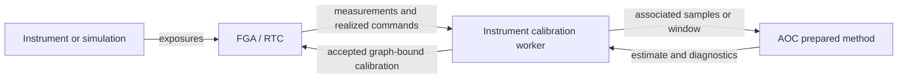

# Soft-real-time AO calibration

A calibration worker can estimate a new interaction matrix from aligned
telemetry while the RTC continues using its current reconstructor. Workers can
also fit the response to a periodic dither or a slow focal-plane amplitude
scan. The update cadence belongs to each calibration. A 128-exposure fit has
an observation delay of 128 exposure intervals even if the fit itself takes
microseconds.



The worker owns sample association, pacing, missed exposures and acceptance.
It must pair each measurement with the command that contributed to that
exposure. A one-frame slip changes the inferred response. Copy a snapshot
between updates on the owning thread, then pass that independent snapshot to
another task for the solve. A mutable state has one writer. A threshold on a
numerical condition or command amplitude is a scientific input to the method.

## Task coverage on the instrument models

The worker paths below are relative to the shared `adaptive-optics-simulations`
repository at revision `a686320`. Each worker produces a candidate and records the input identity.
The instrument comparisons use AdaptiveOpticsCalibration v0.17.6.

| SRT operation | Numerical implementation in AOC | Runnable integration | Verification evidence |
| --- | --- | --- | --- |
| Shack–Hartmann pixel threshold | `ShackHartmann.SubapertureThreshold` | `tools/shack-hartmann-window.jl`, per-exposure peaks in active lenslet order | Classic CPU detector and built pixel-calibration graph, active-mask and padding fixtures |
| Weighted-centroid window calibration | `ShackHartmann.WeightedCentroidMap` | Same worker, mean calibrated spot images over the window | Classic centroid maps, independent spot-shift and smoothing checks |
| Optical-gain correction update | `OpticalGains.ModalDitherResponse` and `OpticalGainUpdate` | `tools/replay-optical-gain-update.jl`, associated probe and reconstructed-response windows | Common-path and WFS-only probes have separate complex transfer references |
| Atmospheric r₀/L₀ estimation | `AtmosphericParameters.ModalVarianceFit` | `tools/replay-atmospheric-parameters.jl`, measured variances, noise variances and calibrated templates | Independent modal fixtures and the outer-scale support profile |
| Temporal integrator gain selection | `ModalGainOptimization.PSDGainOptimization` | `tools/replay-gpi2-modal-gain.jl` | Delay, leakage and held-out pupil OPD on the GPI2 model |
| Interaction identification and reconstruction | `InteractionMatrices`, `DOCRIME`, `Reconstructors` | Classic interaction campaign, Copper pyramid replay and covariance worker | Matched physical commands, held-out predictions, closed-loop OPD and window delivery are reported below |

| Instrument | Threshold and centroid weights | Bounded optical-gain update | Atmospheric r₀/L₀ fit |
| --- | --- | --- | --- |
| REVOLT Classic | Concurrent CPU observer and recorded-window replay | Probe transfer reference needed | Open-loop Shack–Hartmann tilt replay verified. Outer-scale accuracy unresolved |
| REVOLT Copper | Inapplicable to pyramid pixels | Measured common-path HSDM277 reference for controller coordinate 127. Flat and statically aberrated pupil replays | Calibrated modal variance model needed |
| GPI2 | Inapplicable to pyramid pixels | Common-path and WFS-only simulated probes | Calibrated modal variance model needed |
| CAL2 | Inapplicable to SCC and LLOWFS channels | Probe transfer reference needed | Calibrated modal variance model needed |
| SPIDERS | Inapplicable to SCC and LLOWFS channels | Probe transfer reference needed | Calibrated modal variance model needed |

Each optical-gain reference must describe the same carrier, sample association
and signed response as its measurement. Each atmospheric reference must cover
the same modal coordinates, aperture and sensor transfer as the measured
variances. A temporal *controller* gain calibration supplies neither input.

HEART revision `1e50da7f` documents a threshold based on the active peak
vector. Its implementation includes the padded tail. AOC explicitly limits
the median to the active count. HEART also documents Gaussian smoothing
before clipping a spot image; its implementation overwrites the smoothed
array. AOC smooths the supplied image before clipping and peak normalization.
The optional kernel has zero padding and symmetric support for even and odd
ROI dimensions. The finite nonpositive-spot fallback is a uniform map.

On 64 Classic simulated exposures the concurrent worker and subsequent replay
produced byte-identical FITS arrays. All 184 active 22 × 22 spots had a
positive peak. With a fraction of 0.2 and 2-pixel Gaussian FWHM the
thresholds spanned 59.2–62.1 calibrated ADU.

The GPI2 dither replay used an imposed gain in the offline reconstructor,
measured through the simulated detector and built RTC front end. After four
excited windows per path, the candidate multipliers were within 0.147%
and 0.098% of the known inverse gains for common-path and WFS-only probes,
respectively. A following window with zero probe held each prior value.
An SRT that already demodulates the response can supply the complex ratios
and validity flags directly to `OpticalGainUpdateInputs`.

Copper's `capture-copper` command measures a common-path reference at
62.5 Hz using the physical actuator pattern for controller coordinate 127.
At 40 nm peak actuator OPD, the signed correction-to-probe ratio was
−1.009496 + 0.000176i. The bounded update recovered imposed reconstructor
gains of 0.625 and 1.25 within 0.00017. With the original reconstructor,
a static pupil bias equivalent to 200 nm peak actuator OPD reduced the
in-phase gain to 0.556620. An independent static push–pull measured 0.558617.
These measurements cover a single mode on the static CPU calibration plant.
The instrument recipe and signed reference are documented in
`benchmarks/optical-gain-update/README.md` in the instrument repository.

For atmospheric fitting, three independent 32,768-exposure modal fixtures
gave r₀ = 0.16241–0.16317 m at 500 nm and L₀ = 24 m against known values
of 0.163 m and 24 m. The three 256-exposure Classic detector windows gave
r₀ = 0.132–0.148 m against 0.15 m. Their L₀ minima were 10, 2.5 and 7.5 m
against 30 m. Two score profiles supported values through the Kolmogorov
limit, and the third excluded 30 m at the chosen tolerance. The templates
account for removal of the finite-window mean under the declared layer winds.
These measurements verify the Classic sensor input and leave its outer-scale
accuracy unqualified. A score-tolerance interval describes model agreement
and carries no statistical confidence level.

## Using the methods

The following complete two-coordinate example recovers the interaction
matrix with rows `[2, -1]` and `[0.5, 3]` from samples with a WFS offset.
The conditioning settings illustrate this synthetic case.

```julia
using AdaptiveOpticsCalibration
import AdaptiveOpticsCalibration.DOCRIME as DC

spec = DC.CovarianceSpecification(2, 2)
plan = prepare(DC.CenteredCovariance(), spec)
state = DC.CovarianceState(plan)
workspace = AdaptiveOpticsCalibration.allocate_workspace(plan)
for command in ([1., 0.], [-1., 0.], [0., 1.], [0., -1.])
    measured = [2 * command[1] - command[2] + 8, 0.5 * command[1] + 3 * command[2] - 2]
    process!(state, workspace, plan, DC.CovarianceSample(measured, command))
end
sums = DC.CovarianceSums(state)
empty!(state)
solver = prepare(DC.OpenLoop(DC.ConditioningCriteria(0.01, 0.9, 0.01)), spec)
estimate = process(solver, sums)
@assert estimate.diagnostics.status == DC.Valid
@assert estimate.matrix ≈ [2 -1; 0.5 3]
```

- **DO-CRIME.** Each update uses O(mc + c²) work and owns fixed-size history
  for m measurements and c corrector coordinates. A snapshot copies the two
  matrices. The existing closed-loop solve accepts associated command increments
  and multiplies the covariance estimate by its declared loop gain. Record the
  sign and units of the command coordinate in the recipe before using that path.
- **Modal dither.** Prepare `OpticalGains.ModalDitherResponse` on frequencies
  in Hz and regular frame times in seconds. Each column of the frame × mode
  command and response matrices describes the same mode. The fit estimates a DC
  offset and two quadratures for each signal. The magnitude of their complex
  ratio has response units per command unit. A delayed response has positive
  reported lag modulo 2π. For a relative optical gain, divide by an independently
  measured reference response in the same units. Each mode needs an observable
  carrier and the caller must account for cross-mode contamination.
- **Focal-plane scan.** Prepare `FocalPlaneSharpening.ModalScan()` on the
  sampled amplitudes of one mode, including repeat sweeps, then pass one merit
  value per amplitude. Higher merit is better. Negate the package's
  minimization objective when using `WeightedCoreIntensity`. The result gives
  the best sampled amplitude, residual RMS, and a fitted peak when curvature
  and bracketing support it. The fitted amplitude uses the scan's coordinate
  system, which may be a displacement from a baseline flat.
- **Modal integrator gains.** Supply two regularly sampled frame × mode
  records in the same units and modal basis. The first contains open-loop WFS
  estimates and the second contains independently measured sensor noise. Set
  the delay to the number of samples from computing a command to observing its
  first effect. The product contains the disturbance and noise spectra, the
  selected gain, the predicted true residual variance and the linear gain
  margin for each mode. The caller freezes these gains before closed-loop
  verification.

```julia
using AdaptiveOpticsCalibration, AdaptiveOpticsCalibration.ModalGainOptimization

# open_loop and noise_only are 8192 × nmodes matrices of modal OPD in µm.
spec = PSDGainOptimizationSpecification(; samples=8192, modes=size(open_loop, 2),
    segments=16, sample_rate=1000.0, delay_samples=3,
    gains=0.0:0.025:0.6, minimum_gain_margin=1.5)
result = process(prepare(PSDGainOptimization(), spec),
                 PSDGainOptimizationInputs(open_loop, noise_only))
```

## Comparison and qualification

Use the same realized commands, exposure associations, measurement order, units,
noise realization, and held-out disturbances for each comparison. Freeze cutoffs
and gain settings before scoring. Report both accuracy and the excitation and
exposure cost needed to achieve it. A gain estimator that optimizes under a
different delay, stroke limit or detector noise model answers a different question.

| Scientific operation | Reference behavior and present evidence | Next comparison |
|---|---|---|
| Interaction identification | pyRTC's `Loop.docrimeIM` at `1c0a55e` accumulates aligned uncentered cross and auto moments. FGA's DO-CRIME node accumulates centered sums. AOC checks per-sample sums against FGA fixture values and uses a high-precision centered oracle for small variations on large offsets. | Compare estimates and held-out WFS predictions at equal excitation energy and window length. Include a zero-offset control case, nonzero WFS reference, weak or correlated commands, and a deliberately wrong lag. [pyRTC implementation](https://github.com/jacotay7/pyRTC/blob/1c0a55e81433eb7499808cac9c2641d8d6b4cfd7/pyRTC/Loop.py#L403-L445) |
| Dither gain and phase | FGA measures command and response quadratures over integer periods. AOC tests the corresponding amplitude and lag convention at unit reference response, and supports regular windows containing fractional cycles. HEART's SRT receives demodulated amplitudes and updates bounded correction factors. | Test the full amplitude-to-gain path against HEART for known common-path and non-common-path probes. Score amplitude and wrapped phase error, weak-command rejection and response to a step in true gain. [FGA estimator](https://github.com/DarrylGamroth/JuliaFilterGraph.jl/blob/47fe941e568c6ab160672d362cf61d780c35b11f/julia/FilterGraphAlgorithms/src/algorithms/optical_gain/estimator.jl) |
| Focal-plane sharpening | MagAO-X Eye Doctor fits a quadratic across repeated amplitude sweeps. AOC implements that fit and also supports a core-intensity objective and explicit SPSA/Adam steps. | Replay identical images and modal offsets, including asymmetric PSFs, noise, drift, flat scans and extrapolated peaks. Score optimum error against a dense independent scan and achieved merit on held-out images. [Eye Doctor sampling](https://magao-x.org/docs/handbook/operating/software/utils/eyedoctor.html#sampling) |
| Reconstruction and WFS calibration | AOC TSVD reproduces the three HEART Basic cases below using HEART's coordinate maps. HEART LS can form a prior from actuator locations and atmospheric parameters. Existing AOC MAP takes explicit covariances. HEART also implements threshold, weighted-centroid window and atmospheric-parameter tasks. | Compare rank-deficient Basic cases and LS noise/prior cases. Score held-out predictions in physical coordinates, centroid bias and variance on independent frames, and inferred r₀ and L₀ against known atmosphere inputs. |
| Temporal controller optimization | MagAO-X models error and noise transfer functions for integrator and predictive controllers. AOC optimizes a unity-response integrator with integer delay, using an independent noise-only calibration. The held-out comparison below exercises that controller. | Compare on common instrument telemetry with measured loop delay and modal response. MagAO-X also supports estimating noise from closed-loop telemetry. [MagAO-X modal gain optimizer](https://github.com/magao-x/MagAOX/blob/66a6087f7c4dbb7197468c43c9259d3e8b0350d3/apps/modalGainOpt/modalGainOpt.hpp) · [MagAO-X PSD processing](https://github.com/magao-x/MagAOX/blob/66a6087f7c4dbb7197468c43c9259d3e8b0350d3/apps/modalGainOpt/modalPsdProcessor.hpp) |

The HEART comparison uses source revision `1e50da7f` under
`source/srt/heart/srt`. The relevant entry points are `rpg/rpgBasic.py`,
`rpg/rpgLS.py`, `task/optOpticalGain.py`, `task/optWcog.py`,
`task/optSubapThresh.py` and `task/r0L0Computation.py`. HEART's MV class also
exists; the inspected executor enables Basic and LS. Its temporal-filter command
selects a mock. Distinguish comparison with a reference equation, a named
implementation, and a complete running instrument.

### HEART Basic fixture replay

The CPU comparison used the 376 × 277 FITS interaction matrices from
`rpg/tests/fits` in the HEART revision above. Read the images in the same
logical row/column order as Astropy (transpose the FITSIO.jl primary image).
Use the explicit one-based inactive lists from `test_rpgBasic_Test1` and
`test_rpgBasic_Test2` in `rpg/tests/test_rpgBasic.py`. Remove inactive actuator
columns, run AOC `TSVDInverse(rtol=0, atol=0, n_trunc=3)` in Float64, scatter
the active rows into a full zero matrix, then zero slope columns `2j−1, 2j` for
each inactive lenslet j.

| Interaction / expected control matrix (FITS basename) | Retained rank | Relative Frobenius error | Entries outside HEART's tolerance |
|---|---:|---:|---:|
| `interactionMatrix25102022` / `CMfullAllSubaps` | 274 | 1.26 × 10⁻¹⁴ | 0 |
| `IMconfig1FullColumns` / `CMconfig1Full` | 211 | 3.93 × 10⁻¹⁵ | 0 |
| `IMconfig2FullColumns` / `CMconfig2Full` | 207 | 4.37 × 10⁻¹⁵ | 0 |

HEART's elementwise test uses zero absolute tolerance and relative tolerance
1.5 × 10⁻⁸ for the all-active case and 10⁻⁸ for both masked cases. The result
covers these three spectra. An exact zero singular value can change how the
two implementations count discarded modes. Reusing the same integer cutoff
requires checking that convention for a new fixture.

### Classic and Copper instrument replays

The instrument recipes, runnable comparisons and receipts live in the shared
`adaptive-optics-simulations` repository. Revision `9c83741` includes the
original Classic, Copper and GPI2 controller comparisons. The Classic comparison used 424
fresh noiseless calibration exposures per method and matched the sum of squared
applied physical actuator commands to 2.84 × 10⁻⁸ relative. Both methods used
the same 212-coordinate completion and the same TSVD cutoff. The per-actuator
peak was 10.0 nm for push–pull and 3.35 nm for Gaussian random excitation.
The 128 unseen WFS responses and two noisy closed-loop atmosphere trajectories
were paired between methods.

| Classic metric | Zonal push–pull | Open-loop DO-CRIME |
|---|---:|---:|
| Held-out slope error, RMS (pixel) | 0.001199 | 0.001409 |
| Mean pupil OPD RMS, r₀ = 0.15 m (nm) | 50.44 | 56.38 |
| Mean pupil OPD RMS, r₀ = 0.12 m (nm) | 60.10 | 68.70 |
| Clipped actuator samples, both runs | 0 | 0 |

Each loop ran for 512 frames. OPD scoring used frames 129–512.
The input hashes and per-method settings are in
`test/evidence/classic-docrime-comparison.yaml`. This case supports retaining
the existing Classic push–pull calibration at this acquisition budget.

The instrument follow-up `test/evidence/classic-docrime-rank-diagnostic.yaml`
uses the same frozen matrices on two new seeing sequences. Restricting
DO-CRIME to the 208 TSVD modes retained by push–pull improved DO-CRIME's mean
residual OPD by 0.42 and 0.12 nm relative to rank 212. At equal rank, the
push–pull advantage was still 3.75 and 6.24 nm, with zero clipping across all
six runs. Rank explains only a small part of the difference on these sequences.

The Copper recipe in `revolt-copper/calibration/` uses four ordered
30 × 30 pupil images and 277 physical actuator coordinates. A new noisy
calibration campaign selected a 248-mode Hadamard inverse on validation data.
On two locked repeats its summed squared physical command errors were 0.02248
and 0.02254 µm² OPD. The exact historical JFG controller on those same exposures
gave 0.14116 and 0.14099 µm². The zero-command error was 0.70247 µm². Both
fits use the same rank. The comparison measures transfer to this simulated
optical model and calibration state.

A separate native HEART check replayed 256 recorded 64 × 64 detector frames
from one historical reset window. With the archived detector background and
32-row packet ordering, all 921,600 normalized Float32 pupil samples matched
bit for bit. Summing the same pixels in full-frame quadrant order gave a
relative Frobenius difference of 1.77 × 10⁻⁶. This checks the pupil mapping,
normalization history and startup convention used by the Copper recipe.

In sustained closed-loop simulation, both frozen matrices ran on the same
two seeing sequences, with a 150 nm RMS tilt disturbance and a matched
undisturbed run for each. Each trajectory contained 4,096 exposures. After
the tilt was removed, the historical and newly fitted matrices gave
224.08 and 224.70 nm pupil RMS on the first sequence, and 233.66 and
234.35 nm on the second. The respective recovery times were 81 and 80 frames
on the first sequence and 80 frames each on the second. Both stayed within
the actuator limits. The better locked command prediction did not improve
sustained pupil RMS in these runs. The full procedure and window definitions
are in the instrument repository at `revolt-copper/calibration/sustained-correction.md`.

The concurrent centered-covariance worker processed all 16,380 usable
closed-loop exposure/command pairs in the four disturbance trajectories.
Of 252 complete windows, two took longer than 128 ms after the last exposure.
When the same recorded data were offered on a fixed schedule, all 24 windows
completed on time at 125 Hz. At 500 Hz the outcome depended on sender pacing.
In a controlled follow-up the sleep-then-spin sender completed 41/48 windows
and dropped 51/3,072 exposures. The host did not sustain loss-free 500 Hz
calibration across repeats. These worker products are covariance diagnostics
on feedback telemetry with no independent calibration excitation.

### GPI2 actuator response and modal gain replay

At the GPI2 model's 0.5 ms frame interval, a one-exposure command on the
sampled woofer and tweeter directions produced their full pupil OPD response
on the following exposure. Both tip/tilt stage axes peaked two exposures
after the command and still had a measurable response at lag 12. The demand
graph divides tip/tilt correction between the stage and woofer using a 25 Hz
low-pass filter. The stage therefore falls outside the scalar optimizer's
single-delay model.

For the gain comparison, a projected tweeter direction had a weighted
off-direction response 27.3% as large as its response along the command. The
predeclared limit was 10%. Native controller coordinate 541, selected using
the frozen interaction matrix and reconstructor, gave a signed response of
0.9991 after one exposure with 3.01% off-direction response. The optimizer
was applied to that coordinate alone.

The optimizer used 256 open-loop and 256 independent noise-only samples
and selected a unity-response gain of 0.025. This maps to a native gain of
−0.02502 and gives a gain margin of 80 in the scalar model. In a paired
replay of all 1,509 controller coordinates, the accepted −0.3 gain and the
candidate produced true modal residual standard deviations of 34.31 and
48.83 nm over 256 held-out exposures. Whole-pupil RMS rose from 19.10 to
19.23 nm with zero constraint feedback in both runs. The accepted gain
performed better on this disturbance and detector seed. The replay and
receipt are in the instrument repository at `gpi2/calibration-replay/`.

### Temporal gain selection on held-out modal OPD

Run `julia --startup-file=no --project=. benchmark/modal_gain_replay.jl`.
Three simulated modes combine colored or white disturbances, narrow vibration
and independent measurement noise. Use 131,072 open-loop samples at 1 kHz,
an independent noise-only record of the same length and 128 nonoverlapping
segments. Remove each complete record's mean. The one-sided periodogram
integrates to population variance with bin spacing 0.9765625 Hz. Average
before subtracting noise and floor the resulting disturbance power at zero.
The floor can bias the estimated power upward in noise-dominated bins.

The grid spans 0 through 0.6 in increments of 0.025. The model delay is three
frames and the required gain margin is 1.5. Freeze gains on the training data,
then advance a time-domain integrator on a separately seeded 131,072-sample
record after 2,048 warmup samples. Both optimization and scoring use true
residual OPD variance in µm². Prediction uses only the estimated spectra while
scoring uses the simulated disturbance truth. The replay also evaluates each
eligible gain on the same held-out series for comparison.

| Mode | Selected gain | Gain margin | Predicted variance (µm²) | Held-out variance (µm²) | Zero-gain variance (µm²) |
|---|---:|---:|---:|---:|---:|
| Slow disturbance and 8.3 Hz vibration | 0.250 | 2.472 | 0.001761 | 0.001664 | 0.01570 |
| Faster disturbance and 36.7 Hz vibration | 0.075 | 8.240 | 0.004311 | 0.003922 | 0.004730 |
| White disturbance | 0 | ∞ (disabled) | 0.02268 | 0.02257 | 0.02257 |

All three selections minimized the measured variance on the held-out grid.
The largest relative variance prediction error was 9.91%. Independent
state-transition eigenvalues put the stability crossing within ±0.1% of
the predicted margin for each active gain. These values describe a linear
unsaturated controller with uncorrelated disturbance and noise. Fractional
delay, variable sample times, coupled modes and the transfer function of a
specific RTC require separate calibration.

## Delivery order

1. Exercise the scalar CPU methods against independent equations and adverse
   inputs. Measure allocation and compute time for the exact prepared call.
   The timings below cover the covariance update, dither fit and focal-plane
   scan. The modal-gain replay above measures scientific accuracy.
2. Replay named RTC measurements. For REVOLT Copper, keep the graph recipe,
   coefficient bindings and qualification in the shared
   `adaptive-optics-simulations/revolt-copper/` instrument directory. Use
   historical 3,600-pixel controller data as a comparison fixture. Check
   command sign, pupil-block order, µm OPD scaling, references and exposure
   delay through the actual front end. For each candidate matrix score
   held-out predictions and closed-loop pupil OPD RMS against the selected
   reconstruction on the same plant. Repeat for each sensor and controller
   that will adopt the method.
3. Bind the WFS estimators, bounded optical-gain update and atmospheric fit
   to further instrument-specific telemetry where their inputs are available.
   Compare against MagAO-X on common instrument telemetry. Use physical error budgets to set
   equivalence margins before examining the held-out data. Report confidence
   intervals across independent runs for claimed improvements.
4. Measure completion on the deployment host under the intended acquisition
   schedule, including window fill, queue delay, simultaneous solve, rejected
   frames and recovery. Record p50, p99, maximum, missed windows, sample loss
   and memory. Faster isolated calls can coexist with missed application windows.

Run the local accuracy and service-time experiment with
`julia --startup-file=no --project=. -t1 benchmark/soft_realtime_calibration.jl`.
It compares two reductions of five identical command/measurement pairs and
times three serial CPU operations after warmup. The 376 × 212 case uses the
dimensions of the Classic simulation with synthetic varying inputs.
Initialization, compilation, acquisition, snapshot copies, matrix solve,
transport, and queueing are outside the timed updates. Re-run with deployment
dimensions before choosing a calibration cadence.

### Local CPU results

On the five-pair open-loop fixture, both reductions recovered the zero-offset
matrix to roundoff. Adding a constant WFS reference of `[32, -16]` produced
relative Frobenius errors of 2.70 × 10⁻¹⁶ for AOC and 2.23 for the uncentered
moment equation. The finite command window has nonzero sample mean. Centering
removes the intercept term exactly in real arithmetic. This comparison evaluates
the published pyRTC equation on supplied pairs and does not time its controller.

Three fresh Julia 1.13.4 processes ran on a Ryzen 7 6800H under Linux 6.12.117,
pinned to logical CPU 6 with one Julia thread and one BLAS thread. CPU 6 was
shared. Each process made 64 warmup calls followed by an allocation check and
2,000 timed calls per operation. The table shows the range across runs and
the largest individual duration. All three allocation checks measured zero
Julia heap bytes per warmed call in each process.

| Prepared CPU operation | p50 | p99 | Largest duration |
|---|---:|---:|---:|
| DO-CRIME update, 376 measurements × 212 correctors | 65.5–78.5 µs | 12.1–32.2 ms | 40.2 ms |
| Dither fit, 128 frames × 8 modes | 2.13–2.26 µs | 2.33–2.80 µs | 32.0 ms |
| Modal scan, 60 merit samples | 0.220–0.221 µs | 0.221–0.231 µs | 16.0 ms |

These durations include time preempted between the two clock reads. The
experiment measures neither scheduling causes nor response to fixed-rate
arrivals. In particular the covariance timing gives no basis for placing this
worker on a per-frame deadline shared with the fast controller.

The implementation was developed on branch `feature/soft-realtime-calibration`
from `fe8e07c` in a clean worktree. The complete Julia 1.13.4 package suite
passed 2,938 checks, including CPU KernelAbstractions, documentation and method
ambiguity checks. Independent numerical review compared covariance and dither
with higher-precision fits and the scan with a separate QR fit. A malformed
scan plan discovered in review now fails its dimension check before output
writes. Hardware and live instrument qualification remain open.
